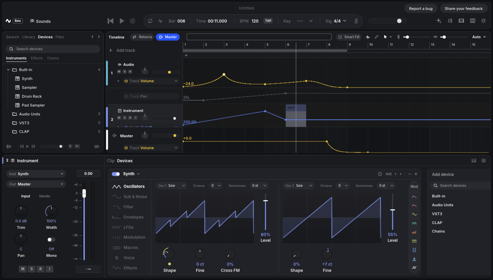
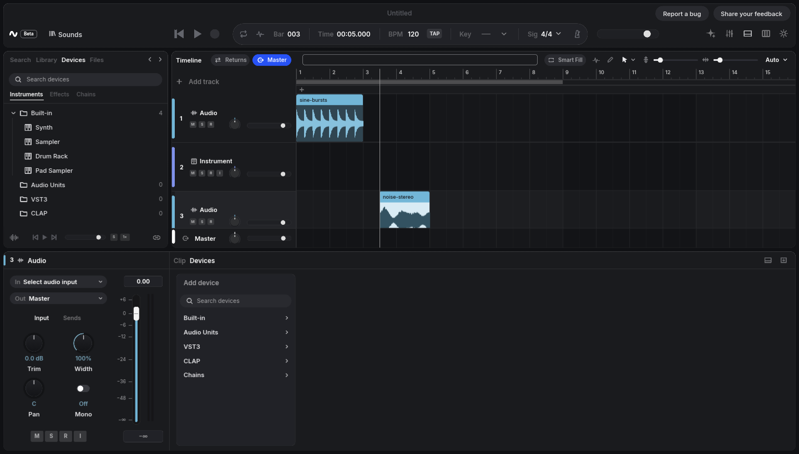
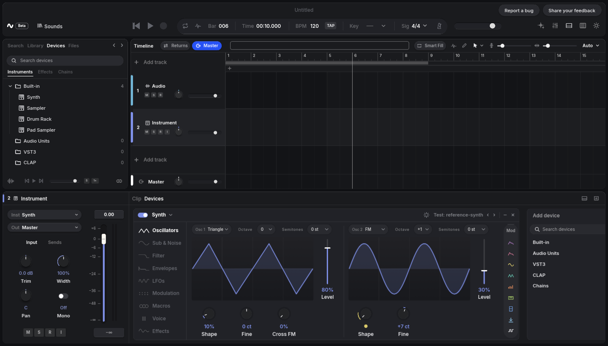
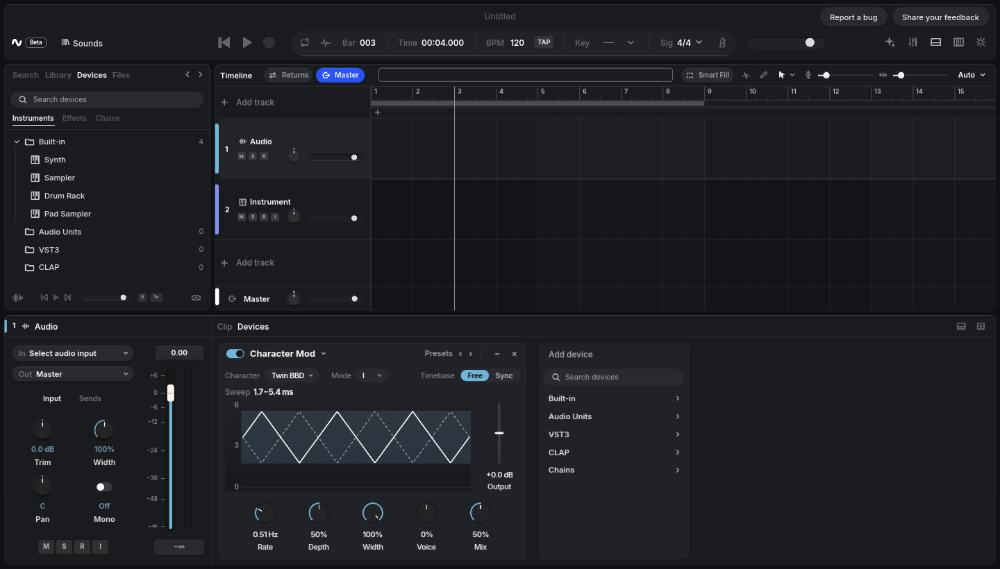
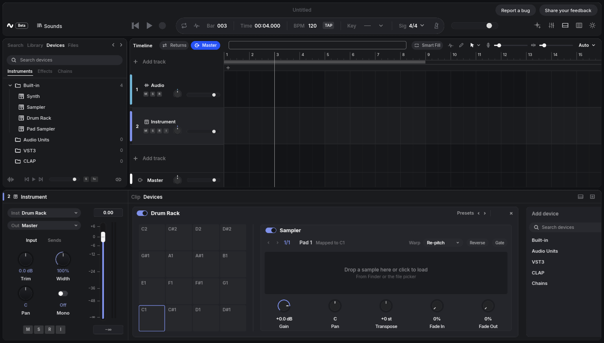

<!-- Keep this README current: see "Keeping this README up to date" under Development. -->

<div align="center">

<h1>Device Studio</h1>

<h3>Built for real time.</h3>

<p>A desktop digital audio workstation with a real-time C++ engine and a GPU-drawn Rust interface, for macOS, Windows and Linux.</p>

<p>
  <a href="https://github.com/chrislaupama/device/actions/workflows/ci.yml"></a>
  <a href="https://github.com/chrislaupama/device/actions/workflows/perf.yml"></a>
  
  
  
  
  <a href="LICENSE"></a>
</p>

<p>
  <a href="#build-from-source"><b>Build</b></a> ·
  <a href="docs/architecture.md"><b>Architecture</b></a> ·
  <a href="docs/devices.md"><b>Devices</b></a> ·
  <a href="PROGRESS.md"><b>Progress</b></a>
</p>

<br>



</div>

---

## What is Device Studio?

Device Studio is a linear, track-based music production program. You record or import audio, write parts in the piano
roll, shape sounds with the built-in instruments and effects or your own AU, VST3 and CLAP plugins, automate anything,
and mix in the mixer. The audio engine is written in C++23 and never allocates or locks on the audio thread; the
interface is written in Rust with Slint, and the timeline, waveforms, piano roll and meters are drawn on the GPU with
wgpu.

> [!WARNING]
> **Device Studio is pre-alpha.** There are no releases yet, features are missing, and the project format may still
> change. macOS is the platform it's developed and tested on every day; Windows and Linux build, but their audio
> backends have never run on real hardware. Keep copies of anything you care about.

## Features

- **Timeline.** Import audio, move and trim clips, loop a range, and play against a metronome. Waveforms, clips and the
  playhead are drawn on the GPU, so the timeline stays at 60 fps with thousands of clips.
- **Piano roll.** Draw, move and resize notes, then quantize, transpose or humanize them.
- **Recording.** Arm tracks, pick inputs, monitor, and record takes that land where you played them: latency
  compensation is measured with an acoustic loopback test, not guessed.
- **Mixer.** Faders, pan, mute, solo, stereo meters with peak hold, and a master strip.
- **Instruments.** A subtractive/FM synth, a sampler, a drum rack and a pad sampler, all built in.
- **Effects.** 20 built-in effects, from compression and saturation to modulation and audio restoration.
- **Modulation and chains.** An LFO that moves any device parameter, and Chains that group effects under eight
  macros.
- **Plugins.** Hosts AU (macOS), VST3 and CLAP plugins. Plugins are scanned in a separate process, so a crashing plugin
  is blocklisted instead of taking the app down, and their editors open in their own windows.
- **Delay compensation.** Plugin latency is compensated across every track, the metronome, recording and export, and
  can be switched off.
- **Automation.** Draw volume, pan, built-in device and plugin parameters as lanes with points, curves or freehand, or
  record your moves with touch-write.
- **Undo for everything.** Every edit is a validated, invertible command, so undo and redo cover the whole project.
- **Assistant.** An optional side panel that can explain the app (Teach) or make edits for you (Assist), each turn as
  one undo step. It uses your own Anthropic API key.

<table>
  <tr>
    <td width="50%"><a href="docs/assets/screenshot-timeline.png"></a></td>
    <td width="50%"><a href="docs/assets/screenshot-synth.png"></a></td>
  </tr>
  <tr>
    <td align="center"><sub>Timeline</sub></td>
    <td align="center"><sub>Synth</sub></td>
  </tr>
  <tr>
    <td width="50%"><a href="docs/assets/screenshot-character-mod.png"></a></td>
    <td width="50%"><a href="docs/assets/screenshot-drum-rack.png"></a></td>
  </tr>
  <tr>
    <td align="center"><sub>Character Mod</sub></td>
    <td align="center"><sub>Drum Rack</sub></td>
  </tr>
</table>

<sub>Screenshots are rendered by the app itself (<code>device-studio --screenshot</code>) on Linux with a software GPU.</sub>

### Built-in devices

Device Studio comes with 44 devices of its own. Each one is a single declarative definition (parameters, panel layout and
factory presets) that the model, undo, saving, automation, engine and panel all derive from, with a C++ DSP kernel
behind it. [docs/devices.md](docs/devices.md) explains how they work and how to add one.

| Kind | Devices |
|---|---|
| Instruments | Synth, Sampler, Drum Rack, Pad Sampler |
| Dynamics and utility | Compressor, Character Compressor, Multiband Compressor, Glue Compressor, Limiter, Mastering Limiter, Gate, Transient Shaper, Utility, Stereo Widener |
| EQ and filter | Channel EQ, Character EQ, Auto Filter |
| Saturation | Distortion, Tape Saturation, Soft Clipper, Bit Crusher |
| Modulation | Chorus, Flanger, Phaser, Tremolo, Auto-Panner, Ring Mod, Character Mod, Trance Gate, Shaper |
| Time and space | Delay, Echo, Reverb, Grains |
| Restoration | De-Noiser, De-Hummer, De-Clipper, De-Esser |
| Pitch and analysis | Pitch Shifter, Pitch Corrector, Tuner, Spectrum |
| Modulators and containers | LFO, Chain |

### Project files

A project is a `Name.dsproj/` folder holding a versioned JSON document, so it diffs cleanly and is easy to keep in
version control. Plugin state is saved inside it. Audio files stay where they are: the project references each one by a
path relative to the project (when both are on the same drive) and by its absolute path. To move a project, move its
media with it and keep the same layout around the project folder, or leave the media at its original absolute path
(always the case for media on another Windows drive). A backup of the project folder alone
does not include the audio, so back up the media too. The format is versioned, but it isn't frozen until the first release.

## Under the hood

```
 Rust app (Slint shell + wgpu surfaces)      crates/dstudio-app
        │  validated commands       ▲ change notifications
        ▼                           │
 Rust core (model, undo, save)               crates/dstudio-core
        │  immutable session snapshot over a C ABI
        ▼
 C++23 real-time engine                      engine/
   Core Audio · WASAPI · PipeWire     AU · VST3 · CLAP hosting
```

- **The UI holds no state of its own.** It renders from the document and the engine's readouts, and every change goes
  through a command, which is what makes undo, saving and the assistant all work the same way.
- **The audio thread never waits.** The engine gets a new immutable snapshot for each edit and swaps it in without
  locks, and old graphs are freed off the audio thread.
- **It's measured.** On an Apple silicon Mac, 128 audio tracks with 4 clips each render a 256-frame block in about
  12 µs, around 0.2% of the 5.3 ms deadline. The benchmark section of the [engine README](engine/README.md)
  has the full numbers, including MIDI, plugins and delay compensation.

Read [docs/architecture.md](docs/architecture.md) for the full specification and [docs/adr/](docs/adr/) for the
decisions behind rendering, recording, plugins, delay compensation and automation.

## Status

✅ works · 🚧 partly works · ⏳ not started

| Area | Status | Still missing |
|---|:---:|---|
| Timeline and audio clips | ✅ | Clip loop, track rename and resize |
| Piano roll and MIDI | 🚧 | Velocity lane, note audition |
| Built-in instruments | ✅ | |
| Built-in effects | ✅ | More devices are planned |
| Plugin hosting | 🚧 | Plugin editor windows on Linux |
| Recording | 🚧 | Per-device manual recording offset |
| Mixer | ✅ | |
| Automation | ✅ | |
| Delay compensation | ✅ | |
| Export | 🚧 | The engine renders to WAV; export from the app isn't wired up yet |
| Assistant | 🚧 | Tested only with a fixture provider, not yet against the live API |
| Windows and Linux audio | 🚧 | Never run on real audio hardware; no ASIO |
| Releases and branding | 🚧 | Packages are built (unsigned); code signing, original icons, a first tagged release |

[PROGRESS.md](PROGRESS.md) has the dated, round-by-round log.

## Get Device Studio

| System | You need | Audio | Plugins |
|---|---|---|---|
| macOS | Apple silicon | Core Audio | AU, VST3, CLAP |
| Windows | Windows x64 | WASAPI (shared mode) | VST3, CLAP |
| Linux | x64, X11 or Wayland | PipeWire | VST3, CLAP (no editor windows yet) |

Every change is built and tested on all three systems in CI, on hosted runners without audio hardware. Real audio
hardware is tested by hand on a Mac.

### Download

**No builds have been released yet.** For now, build it from source. Release packages for macOS (`.dmg`), Windows
(installer and `.zip`) and Linux (`.tar.gz`) are built by the Release workflow and will appear on the
[releases page](https://github.com/chrislaupama/device/releases) once a version is tagged; see
[Release packages](docs/building.md#release-packages).

### Build from source

You need [Rust](https://rustup.rs/) 1.90 or newer, CMake 3.25 or newer, Ninja, and a C++23 compiler (Apple clang,
Visual Studio 2022 or GCC 13). The first build downloads the CLAP headers and the VST3 SDK.
On Linux, install the packages listed in the [build guide](docs/building.md#linux) first.

```sh
git clone https://github.com/chrislaupama/device.git
cd device
cargo run --release -p dstudio-app -- --demo
```

`cargo` builds the engine too, so that's all it takes. `--demo` opens the app with a small demo project; leave it out
to start empty. Use release builds: debug builds abort at exit.

[docs/building.md](docs/building.md) has the packages for each system, the Windows and PipeWire notes, the engine's own
CMake build and tests, and how CI runs.

### Useful options

```sh
cargo run --release -p dstudio-app -- --help                     # every option
cargo run --release -p dstudio-app -- --open My.dsproj        # open a project
cargo run --release -p dstudio-app -- --no-audio                 # run without an audio device
cargo run --release -p dstudio-app -- --self-test --no-audio     # drive the app through its own checks
```

## Development

| Path | What |
|---|---|
| `engine/` | C++23 real-time audio engine, C ABI in `engine/include/dstudio_engine.h` |
| `crates/dstudio-core` | Model, commands, undo/redo, persistence, snapshots, built-in device definitions |
| `crates/dstudio-engine` | Safe Rust wrapper over the engine, end-to-end tests |
| `crates/dstudio-app` | Desktop app (binary `device-studio`) |
| `docs/` | Architecture, ADRs, built-in devices, build guide |
| `specs/` | Specs for non-trivial work, their templates and the project's principles |
| `.agents/skills/`, `AGENTS.md` | Skills and a guide for coding agents working on this codebase |
| `tools/` | macOS app bundle script, the artwork renderer and the skills checker |
| `ui-spike/` | The Slint and wgpu interop spike behind ADR 0001 |

Internal names use `dstudio` (`dstudio-*` crates, the `dstudio::` namespace, `DSTUDIO_*` build options and
environment variables), never `device`, which already names effects and instruments throughout the code.

```sh
cargo test --workspace                     # core, FFI and end-to-end tests
cd engine && cmake --preset default && cmake --build --preset default && ctest --preset default
```

The engine has its own tests (run under ASan and UBSan too) and a benchmark. The app's `--self-test` drives the real
interface end to end, from importing audio to checking that notes drawn in the piano roll sound on the instrument.
Pull requests with visual changes include before and after screenshots, and anything that could affect performance
comes with benchmark results.

Three GitHub Actions workflows check every change: **CI** builds and tests the engine, the workspace and the app on
macOS, Windows and Linux; **Performance** builds the benchmarks at the base commit and with the change and fails a
pull request when any benchmark row needs more than 1 % more CPU instructions (timings on all three systems are
reported too); **Release** builds the installable packages and drafts a GitHub release for a `vX.Y.Z` tag. See
[Continuous integration](docs/building.md#continuous-integration) for the details and how to run the performance
comparison locally.

Start with [PROGRESS.md](PROGRESS.md), then [docs/architecture.md](docs/architecture.md).

Non-trivial work is spec-driven: a feature, a behaviour change or a hard bug starts with a short spec in `specs/`
(what and why, then the plan and tasks), agreed before the code is written, and the spec ships with the change.
[specs/README.md](specs/README.md) explains the workflow and when to skip it, and
[specs/principles.md](specs/principles.md) lists the rules every change follows. If you work with a coding agent,
[AGENTS.md](AGENTS.md) points it at the skills in `.agents/skills/`, which describe how each part of the codebase is
changed; after editing a skill, run `python3 tools/agents/check_skills.py`.

### Keeping this README up to date

This README is the project's front page, so it has to keep up with development. When a change adds, removes or
finishes something it describes, the same pull request updates it:

- **Features** and **Built-in devices** when a feature or device lands or is removed (the device count too).
- **Status** when an area moves between 🚧 and ✅, or a "still missing" item is done.
- **Get Device Studio** and **Build from source** when platform support, requirements or build steps change, along
  with [docs/building.md](docs/building.md).
- **Under the hood** when the benchmark numbers in [engine/README.md](engine/README.md) change noticeably.
- **Screenshots** in `docs/assets/` when the part of the interface they show changes visibly. Render them with the
  app itself, e.g. `device-studio --no-audio --state review-automation --screenshot docs/assets/screenshot.png
  --exit-after-frames 5`; the states used are listed in each image's pull request.

## Contributing

Device Studio is not accepting outside contributions yet: issues, pull requests and comments are limited to the
maintainer for now. You are welcome to read, build and fork the code. [CONTRIBUTING.md](CONTRIBUTING.md) describes how
contributions will work once they open. Security problems can be reported privately at any time as described in
[SECURITY.md](SECURITY.md).

## License

Device Studio is free software: you can redistribute it and/or modify it under the terms of the
[GNU Affero General Public License](LICENSE), version 3 or (at your option) any later version. It comes with no
warranty. In short, you may use, study, change and share it. If you distribute it, modified or not (including as a
binary), you must offer its complete source under the same licence; if you modify it and let people use it over a
network, you must offer them the modified source too.

Third-party code keeps its own license. The engine's dependencies, the VST3 SDK, CLAP headers and Signalsmith libraries
(MIT), dr_libs (public domain or MIT-0) and stb_vorbis (public domain or MIT), are fetched at build time and listed in
[engine/third_party_licenses.md](engine/third_party_licenses.md). The app uses Slint under its
[GPL-3.0 licence](https://github.com/slint-ui/slint/blob/master/LICENSE.md) (compatible with the AGPL), and the bundled
Inter font is under the SIL Open Font License.
