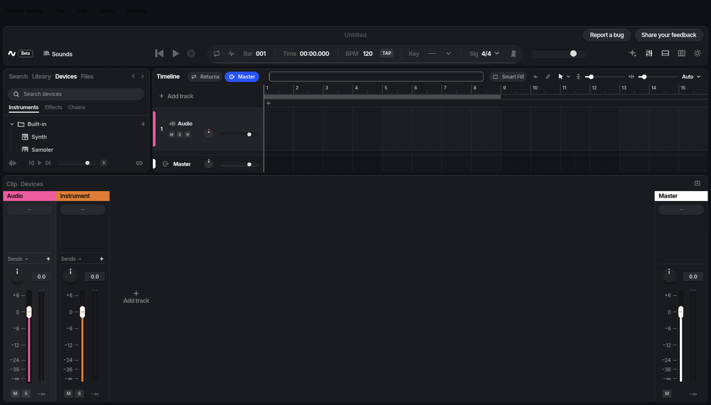

# Pull request media

Screenshots, recordings and other media that explain a pull request live on the `pr-screenshots` branch, not on the
pull request's own branch. That keeps them out of `main` and out of every clone's history, while the links in the
pull request keep working after its branch is deleted.

Contributors without push access to this repository drag their images into the pull request description instead;
GitHub hosts them. Everything below is for the maintainer and the agents working on the repository.

## The branch

- `pr-screenshots` is an orphan branch: it shares no history with `main` and holds only media, one folder per change,
  plus a short README.
- It is never merged anywhere, and no workflow runs on it.
- Only add commits on top of it. Never delete it, force-push it or rewrite its history: the links in pull requests
  point at its commits, and a rewrite would break them.
- If it is ever missing, create it with `git switch --orphan pr-screenshots`, add the media and a README, and push.

## What goes there

| Goes on `pr-screenshots` | Stays in the repository |
|---|---|
| Before and after screenshots of a visible change | Images the README or the docs show (`docs/assets/`, sources in `docs/art/`) |
| Short screen recordings of an interaction | Test fixtures and the files tests read |
| Diagrams or charts drawn for one pull request | Anything the app or the build uses |
| Short audio examples (a before and after render) | |

Only the app's own output and work made for this project: no captures of other products, no third-party images, no
personal data, and nothing secret (a screenshot of a settings page can show a path, a device name or a key).

## Layout and names

- One folder per change, in kebab-case, named after the change rather than the pull request number, for example
  `return-tracks/` or `export-range/`. A later round for the same change adds files to the same folder.
- File names say what they show: `before-mixer.png`, `after-mixer.png`, `after-strip-sends.png`,
  `drag-send-knob.gif`. Before and after pairs share the rest of the name.
- Take before and after shots of the same review state at the same size and zoom (see the `dstudio-ui` skill), so the
  pair compares cleanly.

## Formats and sizes

| Kind | Use | Shows in the description |
|---|---|---|
| Screenshot | PNG (JPEG for photos) | Inline |
| Interaction | Animated GIF or WebP, a few seconds, cropped to the area that changes | Inline, plays in place |
| Longer recording | MP4 (H.264) | As a link that downloads the file: GitHub plays only videos uploaded through its own editor |
| Diagram | PNG; keep the SVG source next to it if there is one | PNG inline |
| Audio | WAV or MP3, a few seconds | As a link |

Keep each file small: a screenshot under about 2 MB, a recording under about 10 MB. GitHub warns above 50 MB and
refuses files over 100 MB, and every file stays in the branch's history for good.

## Adding media

From a checkout of this repository:

```sh
git fetch origin pr-screenshots
git worktree add ../pr-media origin/pr-screenshots   # a separate folder on the branch
cd ../pr-media
mkdir -p return-tracks
cp /tmp/before-mixer.png /tmp/after-mixer.png return-tracks/
git add return-tracks
git commit -m "Add return tracks mixer screenshots"
git push origin HEAD:pr-screenshots
git rev-parse HEAD                                   # the commit to link
```

If the push is refused because someone else pushed first, put your commit on top of theirs and push again:
`git fetch origin pr-screenshots && git rebase origin/pr-screenshots && git push origin HEAD:pr-screenshots`.
Rebasing your own commit that was never pushed is fine; never force-push.

Remove the folder afterwards with `git worktree remove ../pr-media`.

## Linking

Link each file by the commit that added it, not by the branch name:

```text
https://raw.githubusercontent.com/chrislaupama/device/<commit>/<folder>/<file>
```

A link by commit always shows the file as it was when the description was written; a link by branch name would change
if the file were replaced, and breaks if the file moves. In the description:

```markdown
| Before | After |
|---|---|
|  |  |
```

For a recording or an audio file, link it: `[Dragging a send knob (MP4)](https://raw.githubusercontent.com/...)`.
